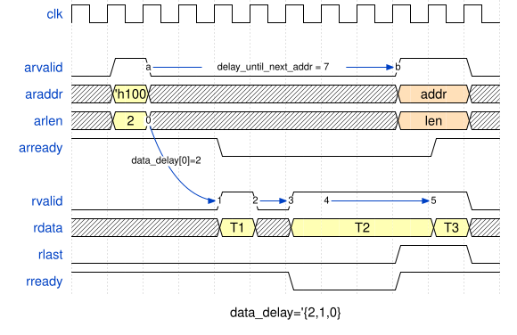
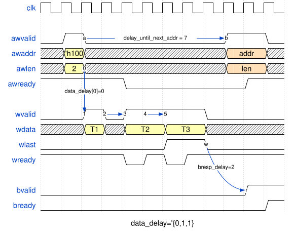
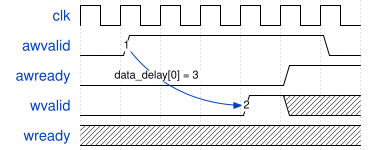
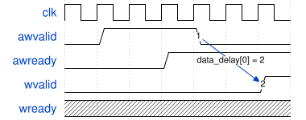
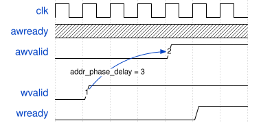

# OVIP AXI

UVM verification IP for the AXI family of protocols -- **AXI3, AXI4, AXI4-Lite**. Each agent is switchable between active master, active slave, and passive monitor. The monitor performs X/Z and signal-stability protocol checks on every channel by default. A sequence library covers single/multi-beat bursts, out-of-order and interleaved traffic, and a memory-backed slave responder. Apache-2.0 licensed; portable across Modelsim/Questa, VCS, and Xcelium.

### At a glance

| Area | Status |
|---|---|
| Protocols | AXI3, AXI4, AXI4-Lite. ACE / ACE-Lite enum values exist but the protocol is **not** implemented |
| Burst types | INCR, FIXED, WRAP |
| Bus widths | 1B - 512B (≥256B is out-of-spec and requires `size_width = 4`) |
| Out-of-order completion | Yes (`*_out_of_order_depth`), with five scheduling algorithms |
| AXI3 W-channel interleaving | Yes (`wr_interleave_depth`) |
| Byte-lane alignment | Auto (default) or manual. Covers narrow transfers, unaligned starts, INCR, and FIXED |
| Mid-test reset | Drivers, monitor, and base slave sequence all recover cleanly. The master driver gives every item that the reset ended back to its sequence, with `dropped_by_reset` set |
| Functional coverage | No covergroups ship today |
| UVM callbacks / transaction recording | Not wired up |

Full known-limitations list lives in [CHANGELOG.md](CHANGELOG.md); wanted-features and good first contributions are in [CONTRIBUTING.md](CONTRIBUTING.md).

## Integrating into your environment

The VIP ships a single compile filelist, [`ovip_axi.f`](ovip_axi.f). Add it to your simulator command and you're done:

```sh
# 1) Tell the filelist where this repo is.
export OVIP_ROOT=/path/to/ovip

# 2) Add ovip_axi.f to your existing compile step.
```

| Simulator | Command |
|---|---|
| Modelsim/Questa | `vlog -sv -mfcu -f $OVIP_ROOT/verif/ovip_axi/ovip_axi.f` |
| VCS             | `vcs -sverilog -ntb_opts uvm-1.2 -f $OVIP_ROOT/verif/ovip_axi/ovip_axi.f` |
| Xcelium         | `xrun -uvm -uvmhome CDNS-1.2 -sv -f $OVIP_ROOT/verif/ovip_axi/ovip_axi.f` |
| Verilator       | `verilator --binary --timing +define+UVM_NO_DPI +incdir+$UVM_HOME/src $UVM_HOME/src/uvm_pkg.sv -f $OVIP_ROOT/verif/ovip_axi/ovip_axi.f` |

The filelist relies on the `OVIP_ROOT` environment variable; nothing else needs to be configured. UVM 1.2 comes from your simulator's built-in library (no source needed); Verilator has none, so `UVM_HOME` is a UVM 1.2 source tree and `randomize()` needs an SMT solver at run time, see [Running on Verilator](../../README.md#running-on-verilator). Apply any [Compile-Time Defines](#compile-time-defines) below as additional `+define+...` arguments on the same compile line.

For a minimal end-to-end example you can run as-is, see [`examples/ovip_axi/01_minimal_loopback/`](../../examples/ovip_axi/01_minimal_loopback/).

## Agent Configuration

Every agent takes an `ovip_axi_agent_config` object (`cfg`). The sections
below describe most of its fields where they apply: the signal widths under
[Signal-Width Limits](#signal-width-limits), the alignment and randomization
switches under [Byte-Lane Alignment](#byte-lane-alignment), then the ready
patterns, the scheduler depths and the transaction log. Three fields select
what the agent speaks:

| `cfg` field | Default | Meaning |
|---|---|---|
| `protocol_type` | `OVIP_PROTOCOL_AXI3` | `OVIP_PROTOCOL_AXI3`, `OVIP_PROTOCOL_AXI4` or `OVIP_PROTOCOL_AXI4_LITE`. On AXI3 the master drives WID, the monitor pairs every W beat with its write by WID, W-channel interleaving is allowed, and a burst has at most 16 transfers: the master driver refuses a longer item, and the monitor reports a longer burst. On AXI4 there is no WID: the W bursts are paired with the AWs in order. On AXI4-Lite every transaction is one beat of the bus width, the agent does not drive or sample AxLEN, AxSIZE, AxBURST, WLAST and RLAST, and `bus_width` must be 4B or 8B (`check_config` reports another width). |
| `interface_type` | `OVIP_AXI_FULL_INTERFACE` | `OVIP_AXI_READ_ONLY_INTERFACE` has the AR and R channels only, `OVIP_AXI_WRITE_ONLY_INTERFACE` the AW, W and B channels only. The drivers and the monitor run only the channels the interface has, and the master driver refuses an item of the other direction. |
| `len_width` | `8` | The number of AxLEN bits the agent uses, 8 at most. The master driver refuses an item whose `len` needs more bits, the monitor samples and X/Z-checks these bits only, and `ovip_axi_bytestream_sequence` cuts its bursts to at most 2^`len_width` beats. |

Set `protocol_type` on every agent. The default is AXI3, so an agent that is
left at the default beside an AXI4 master looks for the ID of every W beat on
WID, which that master does not drive. A write with a non-zero AWID then
never completes: the monitor ends the run with `AXI_MON/TIMEOUT`, or reports
`AXI_MON/INCOMPLETE_WR_TRANS` when the test ends first.

`bus_width` and `addr_width` have no default. `check_config` reports an
agent that leaves either of them unset, and a scheduler depth
(`wr_out_of_order_depth`, `wr_resp_out_of_order_depth`,
`rd_out_of_order_depth`, `wr_interleave_depth`, `rd_interleave_depth`)
below 1.

## Compile-Time Defines

All defines below are passed to the simulator at compile time via `+define+NAME=VALUE` (or just `+define+NAME` for flag-style switches). The VIP supplies sensible defaults in `src/ovip_axi_defines.sv` (guarded by `` `ifndef ``), so you only need to set a define when you want to override it.

### Signal-Width Limits

Each value sets the *physical wire width* of a channel signal in the interface. The agent's runtime `cfg.*_width` fields select how many of those bits are actually active per agent; values above the limit are rejected by `check_config`. Bumping a limit costs sim memory but unlocks larger runtime widths.

| Define | Default | Used for |
|---|---|---|
| `OVIP_AXI_MAX_ID_WIDTH` | `16` | `awid`/`wid`/`bid`/`arid`/`rid` wire width |
| `OVIP_AXI_MAX_ADDR_WIDTH` | `64` | `awaddr`/`araddr` wire width |
| `OVIP_AXI_MAX_USER_WIDTH` | `32` | `awuser`/`wuser`/`buser`/`aruser`/`ruser` wire width |
| `OVIP_AXI_MAX_DATA_WIDTH` | `128*8` (= 1024) | `wdata`/`rdata` wire width. Must be ≥ `bus_width*8` of any agent. Set to `2048` or `4096` for out-of-spec wide buses |
| `OVIP_AXI_MAX_STRB_WIDTH` | `OVIP_AXI_MAX_DATA_WIDTH/8` | `wstrb` wire width. Derived from `OVIP_AXI_MAX_DATA_WIDTH`; override only if you want a non-default ratio |

### Feature Switches

| Define | Default | Effect |
|---|---|---|
| `OVIP_AXI_DISABLE_XZ_AND_SIGNALS_STABILITY_CHECKS` | undefined (checks ON) | Define to opt out of the monitor's X/Z checks on the payload signals and of its signal-stability checks. The X/Z check on the VALID and READY of every channel of the interface stays on, and so do the protocol checks of the channels. The checks are on by default because the protocol violations they catch (X's on a sampled signal, `*valid` deasserted before `*ready`, AxLEN changing mid-handshake, ...) are almost always real bugs. Disable only for early DUT bringup or when the simulation cost is unacceptable. |
| `OVIP_AXI_INCLUDE_USER_DEFINES` | undefined (off) | When defined, the VIP `` `include ``s `ovip_axi_user_defines.sv` from your include path, so you can stash project-local defines/macros without touching the VIP. |

The X/Z check and the stability check skip the data bytes that AXI leaves undefined: a WDATA byte whose WSTRB bit is low, and an RDATA byte lane that a narrow or unaligned beat does not use (see [Bytes under a low strobe](#bytes-under-a-low-strobe) and [Lanes a read beat does not use](#lanes-a-read-beat-does-not-use)). A DUT may leave an X there, and may change the value under VALID. `cfg.check_undefined_data_lanes = 1` (a config bit of the agent, default `0`) makes both checks cover the whole data bus.

### Randomization Limits

Soft upper bounds applied to the **delay** fields of `ovip_axi_trans` so a bare `tr.randomize()` doesn't generate huge timing gaps out of the box. None of these are spec-mandated maximums -- they exist purely to make the default random distribution comfortable. Because the underlying constraints are `soft`, a per-call `with { ... }` clause silently overrides them; to change the default globally, redefine the macro at compile time.

| Define | Default | Bounds |
|---|---|---|
| `OVIP_AXI_TRANS_RD_DATA_DELAY_MAX` | `30` | Each entry of `data_delay[$]` when `tr_type == READ` (slave-side per-beat read data delay). |
| `OVIP_AXI_TRANS_WR_DATA_DELAY_MAX` | `30` | Each entry of `data_delay[$]` when `tr_type == WRITE` (master-side per-beat write data delay). |
| `OVIP_AXI_TRANS_WR_RESP_DELAY_MAX` | `30` | `bresp_delay` (slave-side BRESP timing). |
| `OVIP_AXI_TRANS_ADDR_PHASE_DELAY_MAX` | `30` | `addr_phase_delay` (master-side gap when `data_start_event == BEFORE_ADDR`). |
| `OVIP_AXI_TRANS_NEXT_ADDR_DELAY_MAX` | `30` | `delay_until_next_addr` (master-side pacing between consecutive address phases). |
| `OVIP_AXI_TRANS_NEXT_DATA_DELAY_MAX` | `30` | `delay_until_next_data` (master-side pacing between consecutive data phases). |

`len`, `size`, and `addr` are intentionally **not** capped: users pin them to their test's needs anyway, and [What `randomize()` leaves to you](#what-randomize-leaves-to-you) lists everything an item needs before an agent takes it. Override a delay bound per call:

```systemverilog
tr.randomize() with { delay_until_next_addr inside {[40 : 60]}; };
```

or globally:

```
+define+OVIP_AXI_TRANS_RD_DATA_DELAY_MAX=100 +define+OVIP_AXI_TRANS_WR_RESP_DELAY_MAX=5
```

#### What `randomize()` leaves to you

An `ovip_axi_trans` does not know the agent it will be sent to. Its
constraints hold what is true on every agent: no reserved burst type, a FIXED
burst of 16 beats at most, a WRAP burst of 2, 4, 8 or 16 beats at an aligned
address, one data beat and one strobe beat per transfer of a write and none
on a read, and no negative delay. The widths of the agent, its bus width, its
protocol and the 4KB rule are not in them. So a bare `tr.randomize()` almost
always gives an item that the master driver refuses. Constrain these yourself,
in the `with` clause or by setting the field after the call:

- `id`: inside `cfg.wr_id_width` for a write, `cfg.rd_id_width` for a read.
- `awuser`, `wuser`, `aruser`: inside their `cfg.*user_width`, so 0 when the
  width is 0.
- `addr`: inside `cfg.addr_width`.
- `data_beats[i]`: inside the bus, `cfg.bus_width` bytes.
- `size`: not above the bus width, and exactly the bus width on AXI4-Lite.
- `len`: 15 at most on AXI3, 0 on AXI4-Lite.
- An INCR burst: inside one 4KB page.
- `strb_beats[i]`: legal strobes. With `auto_byte_lanes_alignment` that is
  one bit per byte the beat carries, from bit 0 (see
  [Byte-Lane Alignment](#byte-lane-alignment)).
- `data_start_event`: the event you mean. A bare call picks one of the three,
  and `OVIP_AXI_DATA_START_EV_ADDR_SAMPLED` makes WVALID wait for AWREADY (see
  [Address & Data Channels Timing Dependency](#address--data-channels-timing-dependency)).

The master driver ends the run with UVM_FATAL on an item that breaks one of
the first six, `aruser` excepted, which it does not check (see
[Items the driver refuses](#items-the-driver-refuses)). The monitor reports a
burst across 4KB and a strobe outside the beat's bytes
(`AXI_MON/INVALID_WSTRB`), and the base slave sequence then answers SLVERR.
`axlock`, `axcache`, `axprot`, `axqos` and `axregion` come out with any value,
and the agent drives each only when its `cfg.*_en` bit is set.

An example for an AXI4 agent with an 8B bus, 32 address bits, 4 ID bits, no
user signals and `auto_byte_lanes_alignment`:

```systemverilog
ok = tr.randomize() with {
    tr_type == OVIP_AXI_WRITE_TRANS;                     // or OVIP_AXI_READ_TRANS
    addr inside {[32'h1000_0000 : 32'h1000_0FFF]};       // inside addr_width
    id < 16;                                             // inside wr_id_width and rd_id_width
    awuser == 0; wuser == 0; aruser == 0;                // the user widths are 0
    size <= OVIP_AXI_SIZE_8B;                            // not above the 8B bus
    burst == OVIP_AXI_BURST_INCR;
    len < 16;                                            // 16 transfers fit AXI3 too
    (addr & 12'hFFF) + ((len + 1) << size) <= 13'h1000;  // the burst stays inside 4KB
    data_start_event == OVIP_AXI_DATA_START_EV_ADDR_DRIVEN;
};
// data and strobes at bit 0, on the bytes the beat carries
foreach(tr.data_beats[i])
begin
    int bytes = (i == 0) ? (1 << tr.size) - (tr.addr % (1 << tr.size)) : (1 << tr.size);
    tr.data_beats[i] &= (ovip_axi_data_t'(1) << (bytes * 8)) - 1;
    tr.strb_beats[i] &= (ovip_axi_strb_t'(1) << bytes) - 1;
end
```

On Verilator keep `tr_type` in the `with` clause, as the example has it. With
Verilator 5.053 and the yices solver, a call that left the direction free
gave a write with no data beats and a read with one.

### Notes on Wide Buses (Out of Spec)

`OVIP_AXI_BUS_WIDTH_256B` and `OVIP_AXI_BUS_WIDTH_512B` require AxSIZE > `3'b111`, which violates the AXI spec. To use them:

- Set `OVIP_AXI_MAX_DATA_WIDTH ≥ bus_width*8` (e.g., `4096` for 512B buses).
- Leave `size_width` at its default `3`: `check_config` auto-bumps it to `4` (with a UVM_INFO) whenever `bus_width > 128B`. The `awsize`/`arsize` wires are 4 bits wide so spec-compliant agents (size ≤ 7) are unaffected.


### Clocking-Block Skews

| Define | Default | Used for |
|---|---|---|
| `OVIP_INPUT_SKEW` | `1step` | Input skew of the interface's clocking blocks (`monitor_cb`, `master_cb`, `slave_cb`): the value from before the clock edge. Shared by every OVIP VIP (`ovip_common/ovip_common_defines.sv`). |
| `OVIP_OUTPUT_SKEW` | `0` | Output skew of the same clocking blocks. |

## Basic Timings

### Read Transaction Timing

Read transaction timing is fairly simple. On the master driver side, there is only `delay_until_next_addr`, which indicates the number of cycles after sampling (`arvalid & arready`) to hold the address channel before sending a new read request. On the driver side, there is an array called `data_delay` which stores the delay in cycles between data beats. The first element stores the delay between the request and the first data beat, and all other elements store the delays between each consecutive beat. Note that the delay is counted from the driving start time (`rvalid == 1`) and not from sampling (`rvalid & rready`). Additionally, one can use `delay_until_next_data` to delay any subsequent read response.

For example, in the following paragraph, `data_delay[0]` corresponds to the delay between points 0 and 1, `data_delay[1]` applies to points 2 and 3, and `data_delay[2]` is used for points 4 and 5. Note that for this specific `rready` behavior, changing `data_delay[2]` to 1, 2, or 3 won't change anything.



### Write Transaction Timings

From the slave driver's perspective, the only parameter to adjust is `bresp_delay`, which determines the delay between sampling the last beat and driving the response. On the master driver side, two primary variables control timing: `delay_until_next_addr`, which functions similarly to the AR channel, and `data_delay`, which resembles the read data channel with a distinct difference explained in the following section.



### Address & Data Channels Timing Dependency

The delay between the address phase and the first data beat can be controlled with these variables: `data_delay[0]`, `data_start_event`, and `addr_phase_delay`. `data_start_event` indicates the event which serves as the base point to set the delay. It can be set to three different values:

1. **DATA_START_EV_ADDR_DRIVEN**:
   When `data_start_event = DATA_START_EV_ADDR_DRIVEN`, `data_delay[0]` defines the delay between address phase driving and data phase driving. Setting it to 0, for example, will drive both the address and data in the same cycle.



2. **DATA_START_EV_ADDR_SAMPLED**:
   Similar to `DATA_START_EV_ADDR_DRIVEN`, but in this case, `data_delay[0]` is counted from address phase sampling (`awvalid & awready`).

   So WVALID waits for AWREADY. AXI forbids that of a master: "the master must not wait for the slave to assert AWREADY or WREADY before asserting AWVALID or WVALID". It lets a slave wait for WVALID before it asserts AWREADY. Against such a slave the master and the slave wait for each other, and the simulation hangs with no message. Use this event only against a slave that asserts AWREADY without WVALID. A NoC master NI that puts the header and the first data beat in one flit waits for WVALID (logion_tb TB-3).



3. **DATA_START_EV_BEFORE_ADDR**:
   When `data_start_event = DATA_START_EV_BEFORE_ADDR`, `addr_phase_delay` sets the delay between driving the first data beat and the address phase driving. AWVALID rises `addr_phase_delay` cycles after WVALID, and one cycle after it at the least: `addr_phase_delay` 0 and 1 both give a gap of one cycle. The figure shows `addr_phase_delay = 3`.



## Byte-Lane Alignment

In AXI, when a beat is narrower than the bus or the burst starts at an unaligned address, the active bytes have to be driven on the byte lanes that match the address -- not at the LSB of `wdata`/`rdata`. For example, with an 8-byte bus, address `0x05` and a 1-byte beat, the byte must land on lane 5 (`wdata[47:40]`) and `wstrb[5]` must be set. For the next beat at address `0x06` (in an INCR burst), the byte moves to lane 6, and so on.

`cfg.auto_byte_lanes_alignment` (default `1`) decides who places the data on the correct lane:

- **`= 1` (default, recommended):** the user fills `tr.data_beats[i]` (and `tr.strb_beats[i]` for writes) **at bit 0**, as if the bus were lane-0-aligned. The driver shifts each beat into the correct byte lane before driving; the monitor shifts back when sampling, so the value the user sees in `tr.data_beats[i]` is always the natural, lane-0-aligned content. The strobes follow the same rule: the user fills `tr.strb_beats[i]` at bit 0, one bit per byte the beat carries, and the driver shifts it to the lane. The driver does not compute the strobes and does not mask them: a write needs one `strb_beats` entry per beat, and a bit above the bytes of the beat goes out on a lane outside the transfer (`AXI_MON/INVALID_WSTRB`).
- **`= 0`:** the VIP drives `tr.data_beats[i]` straight onto `wdata`. The user is responsible for placing each beat in the right byte lane *and* setting `tr.strb_beats[i]` accordingly. Use this when your test fully controls the wire-level picture (e.g. checking that the VIP reacts correctly to a deliberately misaligned beat).

### Example

8B bus, INCR burst, address `0x5`, size = 1B (so each beat is 1 byte, narrow transfer), 4 beats of `0xA0, 0xA1, 0xA2, 0xA3`:

| | `auto_byte_lanes_alignment = 1` | `auto_byte_lanes_alignment = 0` |
|---|---|---|
| `tr.data_beats[0]` (user fills) | `64'h00000000000000A0` | `64'h0000A00000000000` |
| `tr.strb_beats[0]` (user fills) | `8'b0000_0001` | `8'b0010_0000` |
| `wdata` on the wire (beat 0) | `64'h0000A00000000000` | `64'h0000A00000000000` |
| `wstrb` on the wire (beat 0) | `8'b0010_0000` | `8'b0010_0000` |

The wire picture is identical. Only who shifts the data and the strobes differs. `ovip_axi_master_item_test` sends the left column and checks the wire.

### Burst-type coverage

INCR, FIXED, and WRAP are all supported under auto-alignment, including the corners -- narrow transfers, unaligned start addresses, FIXED with `burst_size == bus_width` at an aligned and an unaligned address (covered by `ovip_axi_fixed_full_width_alignment_test`), and WRAP at all spec-legal lengths (covered by `ovip_axi_wrap_burst_test`). On a full-width transfer with an aligned address the lane offset is zero, so the master driver and slave/monitor sample the data unshifted -- exactly what the user wrote in `data_beats[i]`. The monitor enforces WRAP's spec rules (length ∈ {2,4,8,16} and start address aligned to `burst_size`).

### Bytes under a low strobe

AXI leaves a WDATA byte whose WSTRB bit is low undefined. By default the master drives there what the sequence put in `data_beats`. On a byte that a strobe hole leaves, the byte of the sequence goes out as it is. On the lanes outside a narrow or unaligned beat's window, the master drives zero below the window (the driver shifts the beat up) and the bits of `data_beats` above the beat's bytes above it, so zero when the sequence leaves those bits zero. The wire pictures above are for a sequence that does.

`cfg.randomize_unstrobed_wdata = 1` (master only, default `0`) puts a random value on every such byte instead. A slave or interconnect that uses those bytes then shows it, for example a write packer that ORs whole WDATA words into one flit (logion_formal FV-1). `ovip_axi_unstrobed_wdata_test` checks the switch: the memory takes the strobed bytes alone, and non-zero bytes appear under low strobes.

### Lanes a read beat does not use

AXI leaves an RDATA byte lane that a narrow or unaligned beat does not use undefined. By default the slave drives zero there. A beat uses its size-aligned container, from its first byte to the container's end.

`cfg.randomize_unused_rdata = 1` (slave only, default `0`) puts a random value on every other lane instead. A master or interconnect that uses those lanes then shows it, for example a read packer that ORs whole RDATA words (logion_formal FV-6). An AXI-Lite read uses the whole bus, so the switch does nothing there. `ovip_axi_unused_rdata_test` and its `_no_auto_align` variant check it: the master gets the memory's bytes, and non-zero bytes appear outside each beat's bytes.

### Payload while VALID is low

AXI leaves a channel's payload undefined while its VALID is low. By default the driver drives zero there at reset and after every handshake (`drive_reset_values_when_idle`), or holds the last value.

`cfg.randomize_idle_payload = 1` (master and slave, default `0`) puts random values there instead: on AW, W and AR at a master, and on B and R at a slave. It works with or without `drive_reset_values_when_idle`. An interface that takes a field before its handshake then shows it, for example a NoC interface that takes BRESP while BVALID is low (logion_formal FV-5). `ovip_axi_idle_payload_test` checks it: the data still round-trips, and each of the five channels shows a non-zero payload while its VALID is low.

### A slave that waits for WVALID

AXI lets a slave wait for WVALID before it asserts AWREADY, and forbids a master to wait for AWREADY before it asserts WVALID. By default OVIP's slave drives AWREADY from its ready pattern alone, so it never waits for WVALID.

`cfg.awready_waits_for_wvalid = 1` (slave only, default `0`, read at the start of the run) makes AWREADY follow the pattern only while a write burst has offered WVALID ahead of its AW. That counts WVALID high now, or W beats the slave already took before the AW. A master that waits for AWREADY before WVALID then hangs, for example a NoC slave NI that holds the write header until the AW handshake (logion_formal FV-3), or this VIP's own `DATA_START_EV_ADDR_SAMPLED`. `ovip_axi_awready_waits_for_wvalid_test` checks it: the data round-trips, the slave never takes an AW before its burst offered WVALID, and some AW waits for its W.

## Ready Patterns

The level driven on a `ready` signal (`awready`/`wready`/`arready` on the slave side, `rready`/`bready` on the master side) is controlled by a *ready pattern* (`ovip_axi_ready_pattern_t`), a small struct with two fields:

```systemverilog
typedef struct {
    int unsigned cycles[$]; // per-phase cycle counts
    bit          loop;      // 1 = repeat the cycles queue forever; 0 = play once and hold
} ovip_axi_ready_pattern_t;
```

Each element of `cycles` holds the current level for that many cycles, and the level alternates with the element index -- **even indices drive `0`, odd indices drive `1`**.

```
cycles = '{3, 1, 4, 2}
           |  |  |  |
           |  |  |  +-- ready = 1 for 2 cycles
           |  |  +----- ready = 0 for 4 cycles
           |  +-------- ready = 1 for 1 cycle
           +----------- ready = 0 for 3 cycles
```

When the last element finishes, the `loop` flag decides what happens next:

- `loop = 0` (one-shot): the final level is held until a new pattern is delivered.
- `loop = 1` (repeating): driving wraps back to `cycles[0]` and continues forever.

```
One-shot  : '{cycles:'{3, 1, 4}, loop:0}  // 3 low, 1 high, 4 low, then held at 0
Repeating : '{cycles:'{3, 1},    loop:1}  // 3 low, 1 high, repeat
```

A common idiom is the always-ready pattern `'{cycles:'{0, 1}, loop:0}` -- drive `0` for 0 cycles (no-op), then `1` and hold. This is what every channel's default config uses.

### Delivering a pattern to a driver

There are three ways to hand a ready pattern to a driver:

1. **Via the agent config (defaults).** Set `cfg.default_<chan>ready_pattern` (e.g. `default_arready_pattern`). Each driver starts up using its default until a new pattern arrives. The factory default for all five channels is the always-ready pattern shown above.

   ```systemverilog
   slave_cfg.default_awready_pattern = '{cycles:'{3, 1}, loop:1}; // 3 low, 1 high, repeat
   ```

2. **Via the transaction.** Set the matching `<chan>ready_pattern` field on a transaction (`tr.arready_pattern`, `tr.rready_pattern`, ...). When the driver processes that transaction, any pattern whose `cycles` queue is non-empty replaces the channel's current pattern; leave `cycles` empty (size 0) to keep the existing one.

   ```systemverilog
   tr.arready_pattern = '{cycles:'{5, 1}, loop:0}; // 5 low then held at 1, this transaction onward
   ```

3. **Directly via the driver helper.** Call `<driver>.put_<chan>ready_pattern(cycles, loop)`. The `loop` argument defaults to `0` (one-shot).

   ```systemverilog
   slave_driver.put_arready_pattern('{3, 1, 4});       // one-shot, ends held at ready = 0
   slave_driver.put_arready_pattern('{3, 1}, 1);       // repeating: 3 low, 1 high, repeat
   ```

Internally all three routes feed the same per-channel mailbox; pushing a new pattern preempts the one currently running and restarts driving from its first element.

## Out-of-Order, Interleaving & Scheduling

When out-of-order / interleaving depth is greater than 1, a driver can have several outstanding transactions whose next data beat (or write response) is ready to be driven in the same clock cycle. A per-channel scheduler decides, every cycle, which one of them to drive. It is configured with these `cfg` fields:

| Field | Meaning |
|---|---|
| `wr_out_of_order_depth` / `rd_out_of_order_depth` | How many outstanding transactions deep the scheduler may look (the reorder window). `1` = strictly in-order. |
| `wr_resp_out_of_order_depth` | The same window for the write responses: how many writes that wait for their BRESP the slave's scheduler may look at. `1` = the responses come in the order in which the writes finished their data. A BRESP from deeper than this is `AXI_MON/BRESP_OOO`. |
| `wr_interleave_depth` / `rd_interleave_depth` | How many distinct IDs may have their data beats interleaved concurrently. `1` = no interleaving. |
| `wr_scheduling_alg` / `rd_scheduling_alg` | Which ready transaction to pick each cycle (see below). |

### Eligibility rules (applied before the algorithm)

Each cycle the scheduler first builds the **ready set** -- the transactions eligible to advance this cycle -- using these rules:

- **Reorder window:** only the first `*_out_of_order_depth` entries of the outstanding queue are considered.
- **Per-ID ordering:** AXI requires data for a given ID to stay in order, so at most one transaction per ID is eligible at a time -- the oldest not-yet-complete one. Later transactions with the same ID wait their turn.
- **Per-beat readiness:** a transaction is only eligible once its programmed inter-beat delay has elapsed.
- **Interleave limit:** a *new* ID is only added to the in-flight set while fewer than `*_interleave_depth` IDs are currently interleaved.
- **AXI3 write data order (the W scheduler of a master):** a write starts its data only when every write before it in the queue has started. See [AXI3 write data order](#axi3-write-data-order).

### Scheduling algorithms (`ovip_axi_scheduling_algorithm_t`)

Given the ready set, the algorithm chooses which transaction to drive:

| Algorithm | Behavior |
|---|---|
| `OVIP_AXI_SCH_ALG_RANDOM` (default) | Uniformly random pick among the ready set. |
| `OVIP_AXI_SCH_ALG_ROUND_ROBIN` | Rotate forward through the ready set from cycle to cycle. |
| `OVIP_AXI_SCH_ALG_ROUND_ROBIN_REVERSED` | Rotate backward through the ready set. |
| `OVIP_AXI_SCH_ALG_ALWAYS_FIRST` | Always pick the oldest ready transaction. |
| `OVIP_AXI_SCH_ALG_ALWAYS_LAST` | Always pick the newest ready transaction. |

> Note: round-robin currently rotates over the *positions* in each cycle's ready set, which spreads selection but is not a strict per-ID fairness guarantee (the ready set is recomputed every cycle). See the VIP source `ovip_axi_out_of_order_queue.sv` for exact behavior.

### AXI3 write data order

On AXI3 a slave gets the first W beat of each write in the order of the AW handshakes (spec A5.3.3). After its first beat a write may interleave its beats with those of other writes, up to `wr_interleave_depth` writes at a time. AXI4 has no write interleaving: there `wr_out_of_order_depth` and `wr_interleave_depth` of a master must be `1`.

- **Master.** The W scheduler starts the data of a write only when every write before it in its queue has started. The queue is in AW order, so the first W beats leave in AW order. Inside the reorder window (`wr_out_of_order_depth`) the writes that have started interleave as the scheduling algorithm picks them. So interleaving needs both `wr_out_of_order_depth` and `wr_interleave_depth` above `1`.
- **`cfg.allow_wdata_out_of_aw_order = 1`** (master only, AXI3 only, default `0`) drops this rule: the scheduler may start the data of a later AW first, inside the reorder window. That traffic is illegal on AXI3. The bit is there to inject the error.
- **Monitor.** A first W beat that is out of the AW order is `AXI_MON/WDATA_OOO`. The first W beat of a write may come before its own AW, so the monitor compares the order of the first W beats with the order of the AWs, and reports the one that is out of place when it arrives. The monitor does not use `wr_out_of_order_depth`. Its limit for interleaving is `wr_interleave_depth` (`AXI_MON/INTERLEAVING_EXCEED`).

### Outstanding-transaction limits

The monitor can enforce a limit on how many transactions are in flight at once,
via `cfg.num_outstanding_wr_transactions`, `cfg.num_outstanding_rd_transactions`,
and the combined `cfg.num_outstanding_transactions` (`0` = unlimited). Exceeding a
configured limit raises an `AXI_MON/OUTSTANDING_EXCEED` error.

A transaction counts as outstanding from **whichever phase appears first** until
its completion (BRESP for writes, last beat for reads). This matters for
data-before-address writes (`data_start_event == OVIP_AXI_DATA_START_EV_BEFORE_ADDR`):
such a write is counted as soon as its **data** phase opens it -- not only once its
address arrives -- so the limit reflects work that is genuinely in flight on the bus.

## Monitor Checks

Beside the X/Z check and the stability check, the monitor tests the traffic against rules of the protocol and reports a violation as a `UVM_ERROR` with an `AXI_MON/...` message ID. This section describes the checks whose rule needs more than the message says.

### Reset

While ARESETn is low every VALID must be low. The monitor checks it from the second clock edge of a reset, because a synchronous master or slave sees the reset on the first one. A VALID may rise only after the first rising clock edge where ARESETn is high (spec A3.1.2, Figure A3-1), so a VALID that is high on that edge is an error too. Both are `AXI_MON/BAD_VALIDATOR`. The check of the exit runs once the monitor has sampled ARESETn low, and it reports a `1` only, not an X or a Z: a bench may start with ARESETn high and the wires not driven yet. A handshake on that edge is still sampled, so the transfers after it are matched as usual.

### Responses and the handshakes they depend on

A slave may assert BVALID only after the AW handshake and the last W handshake of the write, and RVALID only after the AR handshake of the read (spec A3.3.1). The monitor tests this on the first clock edge where BVALID or RVALID is high: the handshakes must be on an earlier edge. A VALID that is high too early is reported as `AXI_MON/BRESP` or `AXI_MON/RDATA`, also when its own handshake comes late enough. A response or a read beat that is accepted with no such write or read behind it is dropped.

The monitor expects the AW handshake before the write response on AXI3 too. AXI3 itself does not require it: a slave that takes all the write data and gives the response before it takes the address is legal AXI3 (spec A3.3.2), and it is not legal AXI4. So on AXI3 this check is stricter than the spec, and the error message says so.

### Transaction timeout

Every transaction that the monitor opens has a watchdog. When the transaction is not complete `cfg.tr_timeout_us` microseconds of simulation time after its first phase, the monitor stops the simulation with the `UVM_FATAL` `AXI_MON/TIMEOUT`, which names the transaction. A write is complete at its BRESP handshake, a read at its last R beat. The monitor of a passive agent has the watchdog too.

The default is `50`. The value is a time, not a number of clock cycles: 50 us is 50000 cycles of a 1 ns clock and 50 cycles of a 1 us clock, so set it for the clock of the bench. `0` turns the watchdog off.

### AxCACHE

On an AXI4 agent an AxCACHE value that Table A4-5 of the spec does not list is reserved, and the monitor reports it as `AXI_MON/WR` (AWCACHE) or `AXI_MON/RD` (ARCACHE). The reserved values are `0b0100`, `0b0101`, `0b1000`, `0b1001`, `0b1100` and `0b1101`. The check runs when the agent has the signal (`cfg.awcache_en`, `cfg.arcache_en`). It is not made on AXI3. The request is still passed on as it is: a slave sequence does not see it as a malformed request.

## Transaction Logging

Each agent can write a human-readable log of every completed transaction to a
file -- handy for post-run inspection, diffing two runs, or feeding a script. It
is off by default and enabled per agent through the config object. The log taps
the monitor's analysis port, so it works on both active and passive agents (and
on ACE agents, where the coherency fields are appended to each line).

| `cfg` field | Default | Effect |
|---|---|---|
| `enable_trans_log` | `0` | Turn on this agent's log. |
| `trans_log_file` | `""` | Per-agent file path. Empty -> `"<agent_tag or agent leaf name>_trans.log"`. |
| `trans_log_combined_file` | `""` | When set, the agent *also* appends to this shared file. Give the same path to several agents to get one interleaved, time-ordered combined log. |
| `trans_log_format` | `OVIP_AXI_TRANS_LOG_TABLE` | `TABLE` = fixed columns (below); `RAW` = the transaction's `convert2string()`. |

Each line carries the transaction fields plus four phase timestamps -- address
(`addr@`), first data beat (`dbeg@`), last data beat (`dend@`) and response
(`resp@`) -- so you can see when each phase of a transaction happened:

```
end_time    agent     dir id     addr         beats  size  burst  resp    addr@       dbeg@       dend@       resp@
17.500ns    master0   RD  0x0    0x00000000   1      4B    INCR   OKAY    4.500ns     17.500ns    17.500ns    17.500ns
27.500ns    master0   WR  0x0    0x00000000   1      4B    INCR   OKAY    4.500ns     4.500ns     4.500ns     27.500ns
```

The times are in ns with three decimals, whatever `$timeformat` the bench
sets. They are the `realtime` fields `addr_phase_time`,
`data_phase_begin_time`, `data_phase_time` and `resp_phase_time` of
`ovip_axi_trans`, which the monitor fills on every item.

Example wiring in a test:

```systemverilog
master_cfg.enable_trans_log        = 1;
master_cfg.agent_tag               = "master0";        // filename + line label
master_cfg.trans_log_combined_file = "all_trans.log";  // optional shared log

slave_cfg.enable_trans_log         = 1;
slave_cfg.agent_tag                = "slave0";
slave_cfg.trans_log_combined_file  = "all_trans.log";  // same path -> interleaved
```

This produces `master0_trans.log`, `slave0_trans.log`, and a combined
`all_trans.log` with both agents' transactions ordered by completion time.

## Scoreboard

`ovip_axi_scoreboard` compares two streams of transactions: "expected" on
`exp_ap` and "actual" on `act_ap`. The usual sources are the monitors on the
two sides of a DUT, or a predictor and a monitor:

```systemverilog
master_agent.mon.analysis_port.connect(scoreboard.exp_ap);
slave_agent.mon.analysis_port.connect(scoreboard.act_ap);
```

It pairs the transactions per direction and per ID, in the order each side
delivers them. The two sides may arrive in any order: an item whose partner
is not there yet waits, and is compared when the partner arrives. So it does
not matter which monitor publishes a transaction first, or how long the DUT
takes between its two sides.

A pair is compared with `ovip_axi_trans::compare()`: every field that maps
to an interface signal, the ID and the whole of every data beat included.
That fits two monitors on one bus, or a DUT that passes the IDs and the data
through unchanged.

| Report | When | Meaning |
|---|---|---|
| `AXI_SB/MISMATCH` | when the second item of a pair arrives | The pair differs. The message lists the fields, from `ovip_axi_trans::diff()`. |
| `AXI_SB/ORPHAN` | `check_phase` | An expected transaction with no actual one. |
| `AXI_SB/UNEXPECTED` | `check_phase` | An actual transaction with no expected one. |

The counters `matched`, `mismatches`, `orphans` and `unexpected` hold the
totals, and `report_phase` prints them. Set `defensive_copy_expected = 1`
when the source of the expected items uses one object again for the next
transaction. `ovip_axi_scoreboard_test` is the proof.

## Writing Sequences

This section is about writing your own master-side and slave-side sequences against the VIP. The two sides follow different conventions; both are important to internalize before extending the testbench.

### Master sequences (the get/put model)

The master driver uses UVM's **get/put** pattern, not the more common `get_next_item`/`item_done` pattern. The driver pulls an item off the sequencer via `seq_item_port.get(req)` (which auto-acknowledges the item -- `start_item`/`finish_item` returns *here*), then later pushes the completed transaction back via `seq_item_port.put(rsp)` once the actual bus traffic for that transaction is done.

The consequence:

> ⚠️ **`start_item` / `finish_item` returns as soon as the driver has *accepted* the item, not when the bus transaction completes.** If you call `seq.start(...)` in `main_phase` and immediately drop the objection, the simulation can end with several transactions still in flight, and the monitor will (correctly) flag them as `AXI_MON/INCOMPLETE_*_TRANS`.

Why the get/put model? AXI is inherently pipelined, possibly out-of-order, and (on AXI3) possibly interleaved. With `get_next_item`/`item_done` the driver would have to fully complete each transaction before pulling the next one, which would defeat OOO/interleaving entirely.

The recommended pattern is to extend `ovip_axi_base_master_sequence` (in `verif/ovip_axi/src/seqlib/`), which gives you two helpers that handle the bookkeeping:

```systemverilog
class my_master_seq extends ovip_axi_base_master_sequence;
    `uvm_object_utils(my_master_seq)
    `uvm_declare_p_sequencer(ovip_axi_base_sequencer)

    function new(string name = "my_master_seq");
        super.new(name);
    endfunction

    virtual task body();
        for(int ii = 0; ii < 16; ii++) begin
            ovip_axi_trans tr = ovip_axi_trans::type_id::create($sformatf("tr_%0d", ii));
            tr.tr_type = OVIP_AXI_WRITE_TRANS;
            tr.addr    = 'h1000 + ii*8;
            tr.id      = ii & 3;
            tr.len     = 1;
            tr.size    = OVIP_AXI_SIZE_4B;
            tr.burst   = OVIP_AXI_BURST_INCR;
            // ... fill the rest of the transaction ...
            send(tr); // == start_item + finish_item, with tracking
        end

        // Block until every in-flight transaction has been put() back by the
        // driver. Without this, body() can return before bus traffic finishes.
        wait_for_responses();
    endtask
endclass
```

The base class sets `set_response_queue_depth(-1)` for you so the driver isn't throttled while you're issuing items.

If you'd rather write the loop by hand (you want fine-grained sequencer arbitration, layered sequences, etc.), `seqlib/ovip_axi_simple_wr_bursts_seq.sv` and `seqlib/ovip_axi_simple_rd_bursts_seq.sv` are the canonical templates. They build the `tr_pool` manually, call `start_item`/`finish_item` per item, and then loop over `get_response(...)` at the end.

#### What comes back on a read

The item the driver puts back carries every R beat: `data_beats[i]` is beat
i's data (lane-0 aligned under `auto_byte_lanes_alignment`), `resp_beats[i]`
is beat i's RRESP, and `resp` is the worst of them (DECERR over SLVERR over
EXOKAY over OKAY). So a burst whose middle beat answered SLVERR has
`resp == OVIP_AXI_RESP_SLVERR` and the beat named in `resp_beats`. A write
has `resp` only, the BRESP. The monitor's items carry the same fields.

#### Items the driver refuses

Before it drives an item, the master driver checks it (`check_trans_validity`):
`id`, `addr`, `len`, `awuser`, `wuser` and the write data against the
configured widths, `size` against the bus width, the AXI4-Lite rules (`len`
is 0, `size` is the bus width), `len` against the 16 transfers of an AXI3
burst, the number of `data_beats` and `strb_beats`
of a write (`len`+1 or more) and of its `data_delay` entries (no more than
the data beats), and the direction against `cfg.interface_type`. Each problem
is a `TR_CHK` UVM_WARNING, and an item with a problem ends the run with
UVM_FATAL. These are the checks the driver needs to drive the item. The
protocol checks are the monitor's.

`tr.trust_me_i_am_an_engineer = 1` (default `0`) keeps the warnings and skips
the UVM_FATAL: the driver drives the item as it is. Use it for a test that
sends an illegal transaction on purpose. The slave driver checks the items of
a slave sequence the same way, with the same bit: `id`, `buser`, `ruser` and
the read data against the widths, and the number of read data beats.

#### A reset while items are in flight

A reset ends every transaction in flight. The master driver then gives back,
with `seq_item_port.put()`, every item it took from the sequencer and did not
complete, in the order it took them, and sets `dropped_by_reset` on each. So
`get_response()` and `wait_for_responses()` return for those items too, and
the sequence goes on. It can send new items at once: the driver takes them
after the reset release.

`dropped_by_reset` is 0 on every item that completed. An item with the bit
set has no valid response: a write has no BRESP, and a read holds only the
beats, data and RRESP, that came before the reset. Check the bit before you
use `resp` or the read data:

```systemverilog
get_response(rsp);
if(rsp.dropped_by_reset) begin
    // the reset ended it: send it again, or give up
end
else begin
    // rsp.resp and rsp.data_beats are valid
end
```

The driver clears the bit when it takes an item, so a dropped item can be
sent again as it is. The driver gives the items back one at a time, so a
sequence that waits in `get_response()` takes each one before the next
arrives, and its response queue does not fill up.
`ovip_axi_bytestream_sequence::all_okay()` is 0 when a reset dropped one of
its bursts. A bench that starts new sequences after a reset still has to
kill the old ones, or they go on beside the new ones.
`ovip_axi_mid_test_reset_dropped_items_test` is the proof.

For a subclass of the driver: `held_items[$]` holds the items the driver took
and did not give back yet. `return_item(tr)` gives a completed item back and
takes it off that list, so a subclass that completes an item itself calls it
where it would call `seq_item_port.put(tr)`. `return_dropped_items()` gives
back the rest after a reset. It is an empty hook in `ovip_axi_base_driver`,
which `run_phase` calls after a reset, and the slave driver leaves it empty.

### Byte streams: `ovip_axi_bytestream_sequence`

For data rather than bursts: a `ovip_bytestream` (bytes) lands at `addr`, or
`read_size` bytes come back from it in `data`. The sequence cuts the stream
into bursts of `size` bytes per beat (default: the bus width) and at most
`max_len`+1 beats (default: what the port allows) and sends them back to back
under one `id`, so the driver pipelines them and the responses stay in order.

| `burst` | the stream is | rule |
|---|---|---|
| `OVIP_AXI_BURST_INCR` (default) | the bytes from `addr` upward | an unaligned `addr` uses partial lanes on the first beat; no burst crosses 4 KiB |
| `OVIP_AXI_BURST_FIXED` | a packet into, or out of, one data register at `addr` | beat k carries bytes k·size.. of the packet (fewer when `addr` is unaligned); at most 16 beats per burst |

On a write `strb` holds one bit per byte (all on by default); a byte with its
strobe off is not written. On an AXI3 port every burst has at most 16 beats.
On an AXI4-Lite port every burst is one beat of the bus width whatever `size`
and `max_len` say. WRAP is refused. A stream of no bytes (empty `data` on a
write, `read_size` 0 on a read) sends no burst.

The sequence also runs as a child sequence, started with `uvm_send` or with
`start(sequencer, parent, -1, 0)`: `body()` takes its settings from the
agent's config itself, in `init_stream()`, and does not need `pre_body()`.

```systemverilog
ovip_axi_bytestream_sequence wr = ovip_axi_bytestream_sequence::type_id::create("wr");
wr.addr = 'h1003; wr.max_len = 7;               // bursts of up to 8 beats of the bus width
repeat(500) wr.data.push_back($urandom);
wr.start(master_agent.sqr);
if(!wr.all_okay()) `uvm_error("WR", wr.worst_resp().name())

ovip_axi_bytestream_sequence rd = ovip_axi_bytestream_sequence::type_id::create("rd");
rd.tr_type = OVIP_AXI_READ_TRANS; rd.addr = 'h1003; rd.read_size = 500;
rd.start(master_agent.sqr);
// rd.data holds the bytes; rd.trans[i].resp_beats the RRESP of every beat of burst i
```

Timing is per sequence and applies to every burst: `max_data_delay` (gaps
between W beats), `max_addr_delay` (the gap before the next address),
`data_start_event` with `max_addr_phase_delay` (where a write's data
starts against its address, see Basic Timings), and `rready_pattern` and
`bready_pattern` (the master's R and B stalls, when their `cycles` is not
empty). The default is back to back with every ready high.

After `start` returns, `trans[$]` holds the bursts in order as the driver put
them back: `resp` (BRESP, or the worst RRESP of the burst), `resp_beats` on a
read, `len` and `addr` as sent. `ovip_axi_bytestream_test` is the proof, on a
random bus width and alignment mode per seed, and
`ovip_axi_bytestream_lite_test` on AXI4-Lite.

### Slave sequences (zero-time response rule)

The slave driver pulls one item at a time from the slave sequence via the **response/request port** and immediately uses it to drive the bus:

```systemverilog
forever begin
    p_sequencer.response_req_port.get(req); // wait for a monitor-captured request
    start_item(req);
    // (1) fill req: resp, data_beats, buser/ruser, bresp_delay, data_delay[], ...
    finish_item(req);                       // hand it back to the driver
end
```

> ⚠️ **The slave sequence MUST return its response in zero simulation time** -- i.e., no `@`, no `#delay`, no `wait`, no `@cb` between `get(req)` and `finish_item(req)`.

The slave driver enforces this. After `finish_item` returns the item to the driver, the driver checks whether the clocking-block edge has already been triggered for this cycle:
- If yes (you stayed in zero time), the driver drives the response on the same edge.
- If no (your sequence consumed time), the driver realigns to the next clocking edge and emits `SLAVE_DRV` warning "Slave sequence returned an item off the clocking-block edge; waiting for the next clock cycle to drive it, which affects item scheduling." Set `cfg.suppress_delayed_slave_seq_warning = 1` if you really need this and accept the scheduling impact.

The reason the rule exists: an immediate response (BRESP on the cycle after WLAST, or RDATA on the cycle after ARVALID with no extra gap) is only achievable when the slave sequence is aligned to the clocking edge. Consuming time inside the sequence body adds latency that the rest of the timing model doesn't expect.

**To express response timing without breaking the rule**, set the timing fields on the transaction itself instead of waiting in the sequence body:

| Want | Set on the transaction (not inline delay) |
|---|---|
| Variable BRESP latency after WLAST | `req.bresp_delay = N;` |
| Per-beat read-data spacing | `req.data_delay.push_back(N);` (one per beat) |
| Inject SLVERR / DECERR | `req.resp = OVIP_AXI_RESP_SLVERR;` (every beat of a read) |
| Inject an error on some beats of a read | `req.resp_beats = '{OVIP_AXI_RESP_OKAY, OVIP_AXI_RESP_SLVERR, OVIP_AXI_RESP_OKAY, OVIP_AXI_RESP_OKAY}; req.resp = OVIP_AXI_RESP_SLVERR;` (one entry per beat; `resp` the worst of them) |
| Refuse what the slave does not own | `mem.add_valid_range(base, size)` on the backing memory: a request that touches a byte outside the ranges is answered SLVERR, a read returns zeros, the memory is untouched, and `SLAVE_SEQ/OUT_OF_RANGE` is reported unless `report_out_of_range` is cleared. With no range set every address is in range |
| Pad write response with `buser` | `req.buser = ...;` |
| Pad read response with `ruser` | `req.ruser = ...;` (driver carries it on each beat) |

The driver applies those delays internally between accepting your `finish_item` and driving the corresponding bus signals.

`ovip_axi_base_slave_sequence` (in `verif/ovip_axi/src/seqlib/`) is the canonical template. It walks the read path via `populate_data_from_mem`, the write path via `write_transaction_to_mem`, and demonstrates the zero-time response pattern as well as how to use the trans's timing fields. Subclass it when you need to inject errors, custom delays, or non-default response values -- and only override the parts you care about, leaving the rest to the base.

#### When does a write commit to the backing memory?

The base sequence exposes a single bit, `wr_mem_update_on_bresp`, that controls *when* a captured write actually updates `mem`:

| Value | Commit timing | Models | Notes |
|---|---|---|---|
| `1` (default) | After BRESP is sampled by the master (`tr.transaction_finished`) | A slave that commits the line only after response handshake | A subsequent read to the same address that races BRESP sees the **old** value. Costs one fork-join_none watcher per write (reset-race protected). |
| `0` | Immediately on request reception (right after WLAST is sampled) | A simple write-on-WLAST slave | Subsequent reads see the **new** value immediately. Cheaper in simulation -- no watcher process. |

Both modes correctly skip the memory update on `SLVERR`/`DECERR` (the response code is finalized before the commit decision in either branch). The knob lives on the slave sequence so a single agent can run different slave-sequence subclasses with different commit policies within the same test.

```systemverilog
my_slave_seq seq = my_slave_seq::type_id::create("seq");
seq.mem = mem;
seq.wr_mem_update_on_bresp = 0;   // commit on WLAST (faster, no watcher)
seq.start(slave_agent.sqr);
```

## Reading further

This README covers the surface most users hit day-to-day. For the edge cases -- the per-channel scheduler in `src/ovip_axi_out_of_order_queue.sv`, the per-beat lane math in `src/ovip_axi_trans.sv` (`calculate_transfer_starting_byte_lane`), the slave-sequence extension points in `src/seqlib/ovip_axi_base_slave_sequence.sv`, the monitor checks in `src/ovip_axi_monitor.sv` -- **the code is the authoritative reference**. Some source files open with a short header that says what the file does. Reading the code from whichever function you're using is the fastest way to answer a question the README doesn't address. If you hit something the README *should* spell out and doesn't, an issue or PR is very welcome.

## License

Licensed under the Apache License, Version 2.0 -- see [LICENSE](LICENSE) and [NOTICE](NOTICE).
Copyright 2026 Idan Zaguri.
